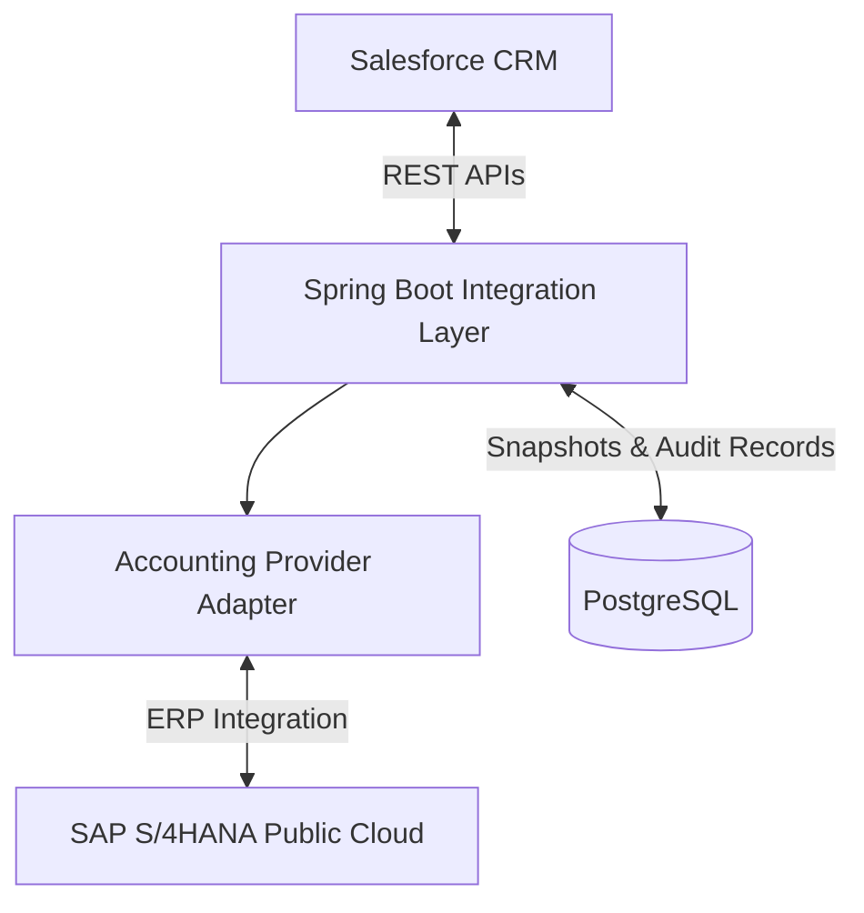

# LedgerBridge

**Connecting CRM and ERP systems through enterprise integration.**

LedgerBridge is a Salesforce–SAP S/4HANA integration project focused on demonstrating an end-to-end Quote-to-Cash workflow. It explores how custom backend services can connect commercial operations in Salesforce with financial processes in SAP, creating a consistent flow of business information across enterprise systems.

## Overview

Organizations often manage customer relationships, sales operations, and financial transactions across separate platforms. LedgerBridge addresses this integration challenge by connecting Salesforce and SAP through a modular Java-based integration layer.

The project demonstrates:
- Salesforce CRM and SAP ERP integration.
- Quote-to-Cash business process automation.
- REST API communication and data transformation.
- Invoice and payment synchronization.
- Financial data visibility within Salesforce.
- Integration monitoring and auditability.

## Architecture

The solution is organized into three primary layers:

| Layer | Responsibility |
|---|---|
| Salesforce CRM | Customer, opportunity, product, and quotation management |
| Integration Services | API orchestration, business logic, data transformation, and synchronization |
| SAP S/4HANA | ERP financial operations, invoice management, and payment processing |

**Supporting infrastructure:** PostgreSQL provides normalized integration records, synchronization snapshots, and audit history.

### System Architecture

## Technology Stack

| Technology | Application |
|---|---|
| Salesforce | CRM and commercial operations |
| SAP S/4HANA Public Cloud | Enterprise resource planning |
| Java | Backend development |
| Spring Boot | Integration services |
| PostgreSQL | Integration persistence and auditing |
| REST APIs | System communication |
| Lightning Web Components | Salesforce user interface |
| Salesforce Flow | Workflow automation |
| Tableau | Financial reporting and analytics |

## Quote-to-Cash Workflow

The intended workflow follows the commercial transaction from sales through financial processing:

1. **Opportunity Management** — Manage customer opportunities and associated products in Salesforce.
2. **Quote Management** — Generate and manage commercial quotations.
3. **Integration** — Transfer relevant transaction information through the Spring Boot integration layer.
4. **ERP Processing** — Connect the commercial transaction to corresponding SAP processes.
5. **Financial Visibility** — Surface invoice and payment information within Salesforce.
6. **Reporting** — Present financial information through dashboards and analytics.

## Engineering Principles

LedgerBridge is designed around several enterprise integration principles:

- **Separation of concerns:** Keep CRM, ERP, and integration responsibilities independent.
- **System-of-record ownership:** Maintain clear ownership of commercial and financial data.
- **Provider abstraction:** Use an adapter-based architecture to isolate accounting provider implementations.
- **Data integrity:** Account for synchronization consistency and transaction traceability.
- **Auditability:** Maintain records of integration activity and data changes.
- **Extensibility:** Support future integration capabilities without tightly coupling individual systems.

## Project Status

**Status: In Development**

The current development focus is establishing the integration architecture and implementing the initial Salesforce–SAP Quote-to-Cash workflow.

Implementation details, setup instructions, and demonstrations will be documented as individual components become available.

## Repository Documentation

Additional technical documentation and implementation walkthroughs will be organized alongside the source code as development progresses.

## Author

**David Lincoln III**

https://linkedin.com/in/david-c-lincoln

Enterprise Software Development | Salesforce | SAP | Java | CRM/ERP Integration
